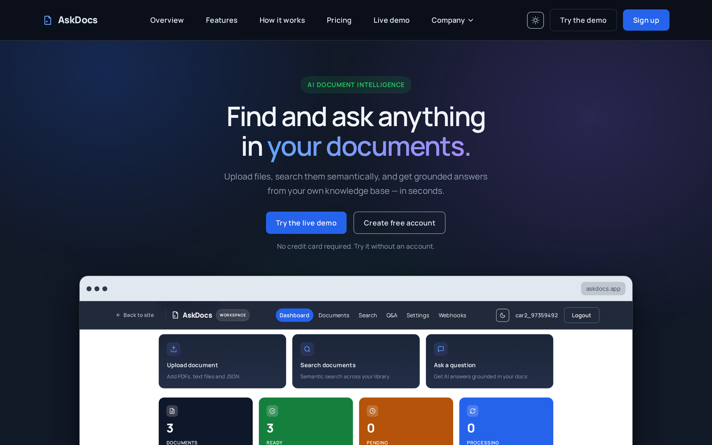
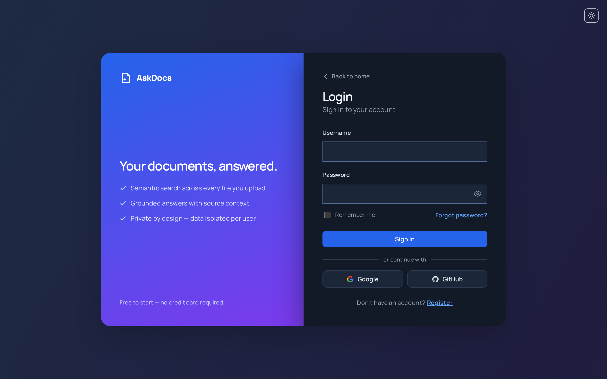
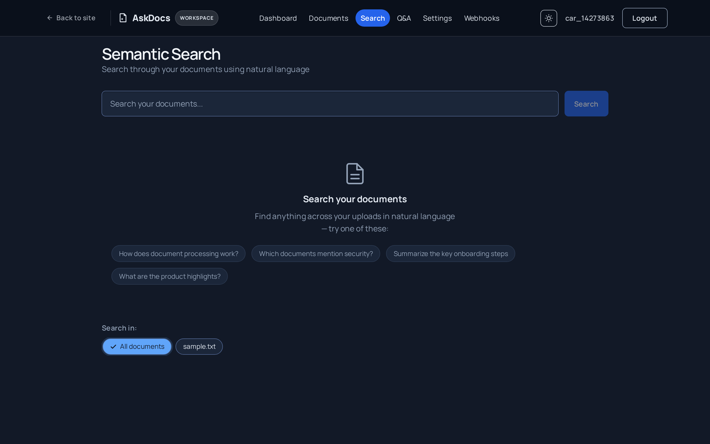
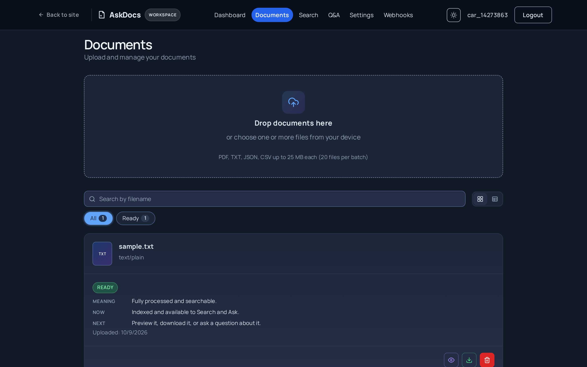

# AI Document Intelligence Platform

<p align="center">
  
</p>

> Upload documents, search semantically, and get grounded answers from your own knowledge base

[](https://www.python.org/downloads/)
[](https://nodejs.org/)
[](https://fastapi.tiangolo.com/)
[](https://react.dev/)
[](.github/workflows/ci.yml)
[](.github/workflows/ci.yml)
[](.github/workflows/infra.yml)
[](LICENSE)

## Table of Contents

- [Home Page](#home-page)
- [Purpose](#purpose)
- [Features](#features)
- [Screenshots](#screenshots)
- [Tech Stack](#tech-stack)
- [Quick Start](#quick-start)
  - [Optional: development mode](#optional-development-mode)
- [Host-Native (No Sandbox)](#host-native-no-sandbox)
- [Common Commands](#common-commands)
- [Troubleshooting](#troubleshooting)
- [Project Structure](#project-structure)
- [Testing & Quality](#testing--quality)
- [Deployment](#deployment)
- [Credits](#credits)
- [AI & Attribution](#ai--attribution)
- [License](#license)

## Home Page

<p align="center">
  
</p>

**AI Document Intelligence Platform** — Upload documents, extract and chunk text, generate embeddings (OpenAI or local models), search semantically with pgvector, and ask questions grounded in your documents with source attribution. Runs locally via Docker Compose; deployable to Kubernetes (Kustomize + Helm) for production.

Key capabilities: document upload/bulk upload, async processing, semantic & keyword search, Q&A with citations, PDF thumbnails/preview, JWT auth with refresh rotation, semantic caching, webhooks, admin dashboard, rate limiting.

## Purpose

This is a full-stack AI Document Intelligence Platform: upload documents, extract and split text, generate embeddings (OpenAI or local models), search semantically, and ask questions grounded in your documents with source context. Everything runs locally for development and is deployable to Kubernetes (Kustomize + Helm) for production.

## Features

- **Document Upload**: Upload single or bulk documents (PDF, TXT, JSON, CSV up to 25MB)
- **Asynchronous Processing**: Text extraction, chunking, and embedding generation in background workers
- **Semantic Search**: pgvector-powered similarity search with keyword fallback when embeddings unavailable
- **Q&A with Sources**: Grounded answers with source attribution across your documents
- **Thumbnails & Preview**: PDF first-page thumbnails and extracted text preview
- **Secure Auth**: JWT authentication with rotating refresh tokens
- **Caching**: Semantic caching for QA and dashboard statistics
- **Webhooks**: Event notifications for document processing lifecycle
- **Admin Controls**: User management, system statistics, and role-based access
- **Rate Limiting & CORS**: Built-in protection with Redis-backed rate limiting

## Screenshots

### 1. Dashboard — Your Workspace at a Glance
<p align="center">
  
</p>
Get an instant overview with document counts by status, recent uploads, and quick access to your most recent activity.

### 2. Documents — Upload & Manage
<p align="center">
  
</p>
Upload single or bulk files, drag-and-drop support, track processing status in real-time, and preview or download processed documents.

### 3. Search — Semantic Search Across Your Files
<p align="center">
  
</p>
Find exactly what you're looking for with vector-based semantic search. Results are ranked by relevance with match percentages, exportable as CSV or JSON.

### 4. Preview — Read Extracted Content Instantly
<p align="center">
  
</p>
Instantly preview extracted text from processed documents with clean formatting and full scrollable content view.

## Tech Stack

| Layer | Technology | Version | Purpose |
|---|---|---|---|
| Frontend | React, TypeScript, Vite | React 19, TS 5.x, Vite 8 | SPA with TypeScript |
| Backend | FastAPI, Python | Python 3.14 | REST API |
| Database | PostgreSQL + pgvector | 15+ | Relational + vector search |
| Cache/Queue | Redis | 7+ | Caching & background jobs (ARQ) |
| Storage | MinIO/S3 | Compatible | Object storage |
| Auth | JWT (HS256) | - | Authentication with refresh rotation |
| AI | OpenAI, Groq, Ollama | Configurable | Embeddings & Q&A |
| Infrastructure | Docker, Kubernetes, Helm | - | Containerization & deployment |

## Quick Start

**Requirements: Docker, and `git` to clone.** Nothing else — no Python, Node
or AI key just to start it. Windows, macOS and Linux all use the same command.

1. Install [Docker](https://www.docker.com/products/docker-desktop/) (Docker
   Desktop on macOS/Windows, Docker Engine + Compose plugin on Linux).
2. Get the code and start the stack from its root:

   ```bash
   git clone https://github.com/fiwon123/ai-document-platform.git
   cd ai-document-platform
   docker compose up
   ```

> **No `git`?** Download the ZIP from the repository's GitHub page instead,
> then run `docker compose up` in the extracted folder.

This one command brings up the whole platform as **five containers**:

| Container | Runs |
|---|---|
| `dev` | the frontend **and** the API (both, in one container) |
| `worker` | the background document processor |
| `postgres` | the database |
| `redis` | the queue and cache |
| `minio` | S3-compatible object storage |

The first run builds the images (a few minutes); later runs start in seconds.

> **Prefer not to tie up your terminal?** Start detached instead —
> `docker compose up -d` — and follow it with `docker compose logs -f` (all
> containers) or `docker compose logs -f dev` (the app only). Everything below
> works the same either way.

**When it is ready**, `docker compose ps` shows all five running (`worker` has no
healthcheck; the other four report `(healthy)`). In the foreground, run that from
a second terminal. Then open the application:

| Where | Address |
|---|---|
| **Application** | http://localhost:5175 |
| **API docs (Swagger)** | http://localhost:8001/docs |
| **MinIO console** | http://localhost:9001 (`minioadmin` / `minioadmin`) |
| PostgreSQL | `localhost:5434` |
| Redis | `localhost:63790` |

> **Start using it right away.** Upload, process, preview and keyword-search
> documents with no configuration at all. Semantic search and Q&A additionally
> need an embedding/chat provider — optional, and covered in
> [DEVELOPMENT.md](./DEVELOPMENT.md) → *LLM provider config in the sandbox*.

**To stop:** if you started in the foreground, `Ctrl+C` in that terminal. If you
started detached (`-d`), run `docker compose down` — pressing `Ctrl+C` there only
stops the log tail, not the stack.

---

**Everything below this point is optional.** It is only for people working
*on* the code. If you came to see the platform run, you are already done.

### Optional: development mode

> Throughout this README, **"the sandbox"** means this Docker Compose stack —
> the same five containers. The commands below wrap those containers rather
> than replace them.

The commands below are a convenience layer over the same Compose files: they
add an interactive shell in the container, `Makefile` short-cuts (`dev-log`,
`dev-down`, and `reset`, which **deletes all data** — see
*[Reset everything](#reset-everything)*) and, on Linux or inside WSL2, the
sandboxed AI coding agent. They start the identical five services.

Everything here is optional — the WSL2 and `make` requirements below apply
**only** if you choose this path.

Pick your platform:

| Platform | Recommended command | In-container agent |
|---|---|---|
| **Linux** | `make dev-up` | ✅ `make opencode` |
| **macOS** | `make dev-up` | ➖ run `opencode` on the host |
| **Windows + WSL2** | `make dev-up` (inside WSL2) | ✅ `make opencode` |
| **Windows native** | `python scripts/dev-up.py dev-up` | ➖ run `opencode` on the host |

All four start the same stack. `make` is the recommended interface on POSIX
hosts; the Python launcher exists because native Windows has no POSIX shell.
Both read the same Compose files as `docker compose up`, so they behave
identically.

**Prerequisites for this optional path:**

| Requirement | Linux | macOS | WSL2 | Windows native |
|---|---|---|---|---|
| Docker + Compose | ✅ | Docker Desktop | Docker Desktop | Docker Desktop |
| `git` | ✅ | ✅ | ✅ | ✅ |
| `make` | ✅ | ✅ | ✅ | ❌ (use Python) |
| Python 3.10+ | optional | optional | optional | ✅ (launcher) |
| `uv` + Node 22 | only for host-native | only for host-native | only for host-native | only for host-native |

`uv`, Node, and the backend virtualenv are **baked into the dev image**; you do
not install them to run the sandbox.

> **The in-container AI agent needs a Linux `opencode` binary.** A macOS or
> Windows binary cannot execute inside the Linux container, so on those
> platforms run `opencode` on the host against the running stack instead. WSL2
> is the one way to get the agent inside the container on Windows.

#### 🐧 Linux

Prerequisites: Docker Engine + Compose plugin, `make`, `git`, and (for the
sandboxed agent) opencode installed with the Linux installer.

```bash
git clone https://github.com/fiwon123/ai-document-platform.git
cd ai-document-platform
make dev-up          # foreground; Ctrl+C stops it
make dev-log         # tail logs (second terminal)
make dev-down        # stop, keep volumes
```

If your user ID is not `1000`, tell Compose who you are — otherwise the
container cannot write to the bind-mounted workspace:

```bash
make dev-up HOST_UID="$(id -u)" HOST_GID="$(id -g)"
```

#### 🍎 macOS

Prerequisites: [Docker Desktop](https://www.docker.com/products/docker-desktop/)
and `make` (install with `xcode-select --install` if missing).

```bash
git clone https://github.com/fiwon123/ai-document-platform.git
cd ai-document-platform
make dev-up
```

Docker Desktop on macOS virtualises file ownership, so the default UID/GID is
fine. The container runs the application and agent tooling, but a macOS
opencode binary cannot execute inside the Linux container — run
`opencode` on the host against the running stack instead of `make opencode`.

#### 🪟 Windows — WSL2 (recommended)

WSL2 gives you a real Linux environment, so every command in this repository
works exactly as it does on Linux — including `make dev-up` and
`make opencode`.

1. **Install WSL2** — in an **Administrator** PowerShell:

   ```powershell
   wsl --install -d Ubuntu
   ```

   Reboot, then finish the Ubuntu user setup.

2. **Install Docker Desktop** and enable
   *Settings → Resources → WSL Integration → your distro*.

3. **Install the host tooling** inside the WSL2 distro:

   ```bash
   sudo apt update && sudo apt install -y make git curl
   ```

4. **Clone and run** from the WSL2 terminal:

   ```bash
   git clone https://github.com/fiwon123/ai-document-platform.git
   cd ai-document-platform
   make dev-up
   make dev-log        # second terminal
   ```

Because WSL2 is Linux, `~/.opencode/bin/opencode` is a Linux binary and the
in-container agent works: `make opencode`.

> **Use the WSL2 filesystem, not `/mnt/c`.** For speed and reliable file
> watching, clone into `~/` (for example `~/code/ai-document-platform`) rather
> than `C:\`. The repository works either way, but hot reload is much faster
> on the Linux filesystem.

#### 🪟 Windows — native (PowerShell)

Native Windows has no POSIX shell, so the Makefile's preflight cannot run
there. Use the cross-platform Python launcher instead. This starts the full
sandbox (app + worker + infrastructure) with hot reload; only the
**in-container** agent is unavailable, because a Windows opencode binary cannot
execute in the Linux container.

Prerequisites:

- [Docker Desktop](https://www.docker.com/products/docker-desktop/) with the
  WSL2 backend enabled (the default).
- **Python 3.10+** — `winget install --id Python.Python.3.12`.
- *Optional, for the AI agent:* opencode installed on Windows, run **on the
  host** while the stack is running.

```powershell
git clone https://github.com/fiwon123/ai-document-platform.git
cd ai-document-platform

# Full sandbox in the foreground (Ctrl+C stops it)
python scripts/dev-up.py dev-up

# Or use the PowerShell wrapper (same thing)
.\scripts\dev-up.ps1 dev-up

# Other commands
python scripts/dev-up.py dev-log
python scripts/dev-up.py dev-down
python scripts/dev-up.py infra-up      # infrastructure only
```

> If PowerShell blocks the script, run
> `powershell -ExecutionPolicy Bypass -File .\scripts\dev-up.ps1 dev-up`.

For the AI agent on native Windows, leave the stack running and start
`opencode` in the repository root in a separate terminal. It edits the same
bind-mounted files the container is serving, so hot reload behaves exactly as
it does inside the sandbox.

### Which mode should I use?

| | `docker compose up` | `make dev-up` / `dev-up.py` | Host-native |
|---|---|---|---|
| Audience | demo, portfolio, reviewers | daily development | backend/frontend debugging |
| Hot reload | ✅ | ✅ | ✅ |
| Background worker | ✅ | ✅ | manual |
| In-container AI agent | ❌ | ✅ (Linux/WSL2) | ❌ |
| Host prerequisites | Docker only | Docker + Make or Python | Docker + uv + Node |
| Platforms | any | any | any |

`docker compose up` and the development commands run **the same five
services**; the difference is convenience, not capability.

## Host-Native (No Sandbox)

Run the application processes directly on your machine while Docker provides
only PostgreSQL, Redis, and MinIO. Useful for debuggers and profilers, or for
editing backend/frontend with your own toolchain.

```bash
# 1. Infrastructure only (works on every OS via Docker)
docker compose up -d postgres redis minio

# 2. Backend (Python 3.14 + uv)
cd backend
uv sync
uv run alembic upgrade head
uv run uvicorn app.main:app --reload --host 0.0.0.0 --port 8000

# 3. Frontend (Node 22), separate terminal
cd frontend
npm install
npm run dev
```

Because the Vite dev server proxies `/v1` to `http://localhost:8000`, use the
default ports here (8000/5173), not the sandbox's published 8001/5175.

> The backend test suite **drops and recreates tables** in `mydb_test`. Never
> point it at a database you care about — see [DEVELOPMENT.md](./DEVELOPMENT.md).

## Common Commands

| Task | Linux / macOS / WSL2 | Windows native |
|---|---|---|
| Start sandbox (foreground) | `make dev-up` | `python scripts/dev-up.py dev-up` |
| Tail logs | `make dev-log` | `python scripts/dev-up.py dev-log` |
| Stop (keep data) | `make dev-down` | `python scripts/dev-up.py dev-down` |
| Restart + rebuild | `make dev-restart` | `python scripts/dev-up.py dev-restart` |
| Shell inside container | `make dev-exec` | `python scripts/dev-up.py dev-exec` |
| Run agent in container | `make opencode` | ➖ run `opencode` on the host |
| Infrastructure only | `make infra-up` | `python scripts/dev-up.py infra-up` |
| Demo (any OS) | `docker compose up` | `docker compose up` |
| Wipe volumes | `make reset` | `docker compose down -v` |

Run `make help` (or `python scripts/dev-up.py help`) for the full list.

## Troubleshooting

### `make: "test -x" is not recognized` / `opencode not found` on Windows

`make` on native Windows runs under `cmd.exe`/PowerShell, not a POSIX shell, so
the Makefile's POSIX preflight cannot work. Use WSL2 (recommended) or the
cross-platform launcher:

```powershell
python scripts/dev-up.py dev-up
```

`make dev-up` no longer requires the opencode binary: the sandbox starts with or
without the in-container agent. Only `make opencode` / `make shell` need a
**Linux** opencode binary (Linux or WSL2).

### `/bin/bash^M: bad interpreter`, `$'\r': command not found`, or `set: pipefail: invalid option name`

The shell scripts were checked out with Windows (CRLF) line endings. The
repository pins LF in `.gitattributes`; re-checkout the files:

```bash
git rm --cached -r . >/dev/null
git reset --hard
```

Confirm with `git ls-files --eol dev-entrypoint.sh` — the working tree (`w/`)
must be `lf`, not `crlf`.

The third form is the same cause reaching bash one step later: `set -euo
pipefail\r` is rejected before any of the entrypoint's own checks can run, so
bash reports `set: pipefail: invalid option name` and names nothing else.
`dev-entrypoint.sh` now detects that itself and prints the remedy above (#762).

### The container cannot write to the workspace

On Linux, the sandbox runs as your UID/GID. If yours is not `1000`:

```bash
make dev-up HOST_UID="$(id -u)" HOST_GID="$(id -g)"
```

If the checkout was previously written to by root:

```bash
sudo chown -R "$(id -u):$(id -g)" .
```

### Port already in use

The sandbox publishes offset ports (`5175`, `8001`, `5434`, `63790`, `9000`,
`9001`) to avoid clashing with other projects. If one is still taken, stop the
conflicting container or override the published port in
`docker-compose.yaml` (left side of `host:container`).

### The stack starts but Q&A returns nothing

No LLM provider is configured. See
[DEVELOPMENT.md](./DEVELOPMENT.md) → *LLM provider config in the sandbox*;
search falls back to keyword ranking and Q&A needs a chat/embedding model.

### Reset everything

```bash
docker compose down -v      # also deletes the database, Redis and MinIO volumes
```

## Project Structure

```
├── backend/                     # FastAPI app, SQLAlchemy models, routes, services
├── frontend/                    # React 19 + TypeScript + Vite SPA
├── infra/                       # K8s (Kustomize + Helm), Docker images, scripts
├── scripts/
│   ├── dev-up.py                # Cross-platform launcher (Windows native + POSIX)
│   ├── dev-up.ps1               # PowerShell wrapper for dev-up.py
│   ├── ensure-sandbox-running.sh
│   ├── open-in-sandbox.sh
│   └── resolve-gh-token.sh
├── docker-compose.yaml          # Base stack — `docker compose up` works standalone
├── docker-compose.agent.yaml    # Optional in-container AI-agent mounts
├── Dockerfile                   # Dev image (uvicorn/vite/worker runtime, deps baked)
├── Makefile                     # POSIX developer workflow (Linux/macOS/WSL2)
├── dev-entrypoint.sh            # Foreground uvicorn + vite with hot reload
├── .gitattributes               # Forces LF so Windows clones run in Linux
└── README.md
```

## Testing & Quality

```bash
# Backend tests (need postgres/redis/minio: docker compose up -d postgres redis minio)
cd backend && uv run pytest

# Backend lint
cd backend && uv run ruff check src/

# Frontend lint & build
cd frontend && npm run lint && npm run build

# Full gate (lint + format + tests + build) — POSIX hosts
make check

# Windows native equivalent
python scripts/dev-up.py dev-exec   # then run `make check` inside the container
```

## Deployment

Production-ready deployment with multi-stage Docker images, Kubernetes manifests, and Helm charts. See:
- [Kustomize](./infra/k8s/) - Base + dev/production overlays
- [Helm](./infra/helm/ai-platform/) - Standalone chart
- [Docker Images](./infra/docker/) - Multi-stage builds
- [CI/CD](./.github/workflows/) - GitHub Actions

## Credits

- [FastAPI](https://fastapi.tiangolo.com/) — High-performance web framework
- [React 19](https://react.dev/) — UI framework
- [pgvector](https://github.com/pgvector/pgvector) — Vector similarity search for PostgreSQL
- [ARQ](https://arq-docs.helpmanual.io/) — Redis-based async task queue
- [MinIO](https://min.io/) — S3-compatible object storage
- [Playwright](https://playwright.dev/) — End-to-end testing & visual captures

## AI & Attribution

This is a portfolio project. AI-assisted development helped accelerate iteration, but all architectural decisions and code are actively curated.

## License

Custom License — see [LICENSE](LICENSE) for details.
